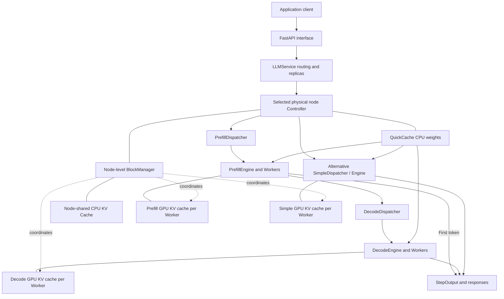

# System Architecture

Simple and P/D are alternative execution modes. Each physical node has one Controller and shared CPU caches; each Worker has its own GPU KV cache, coordinated by the node's BlockManager.

## Components

- **API / LLMService:** request formatting, replica placement, and routing.
- **Controller / Schedulers:** node-local dispatch, batches, and model quotas.
- **StageEngine / Worker:** GPU execution using vLLM models and kernels.
- **QuickCache:** CPU model weights and fast loading.
- **BlockManager:** request KV state and CPU/GPU transfers.

A request selects one READY node. Prefill produces the first token; unfinished requests continue with Decode. Model switches preserve KV state through the node's CPU cache. See [Scheduling](scheduling.md) and [Memory](memory.md) for details.

