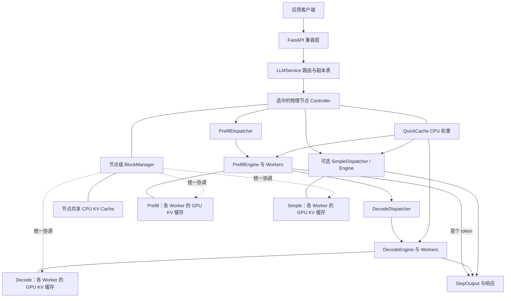

# 系统架构

Simple 与 P/D 是两种可选执行模式。每个物理节点有一个 Controller 和共享 CPU 缓存；各 Worker 分别持有自己的 GPU KV 缓存，由节点的 BlockManager 统一协调。

## 组件

- **API / LLMService：** 请求格式处理、副本放置与路由。
- **Controller / Scheduler：** 节点内分发、batch 和模型配额调度。
- **StageEngine / Worker：** 使用 vLLM 模型与内核执行 GPU 计算。
- **QuickCache：** CPU 模型权重缓存与快速加载。
- **BlockManager：** 请求 KV 状态及 CPU/GPU 搬运。

请求选定一个 READY 节点后，由 Prefill 产生首个 token，未结束的请求再进入 Decode。模型切换通过节点的 CPU 缓存保留 KV 状态。详见[调度](scheduling.md)和[内存管理](memory.md)。

## 源码入口

| 层 | 主要文件 |
|---|---|
| CLI / HTTP | cli.py、api.py |
| 控制面与集群 | llm.py |
| 引擎 / GPU 执行 | stage_engine.py、worker.py |
| 调度 | simple/prefill/decode dispatcher 与 scheduler |
| 权重加载 | loader/、quick_model_loader/ |
| KV 管理 | block_manager.py、cache_groups.py、cache_transfer.py、vllm_cache.py、仓库根目录 ops/ |
| 注册与预算 | config.py、model_registry.py、device_registry.py、estimator.py |
| 图恢复 | cuda_graph.py、graph_config.py、graph_bindings.py、foundry_runtime.py、foundry/ |
